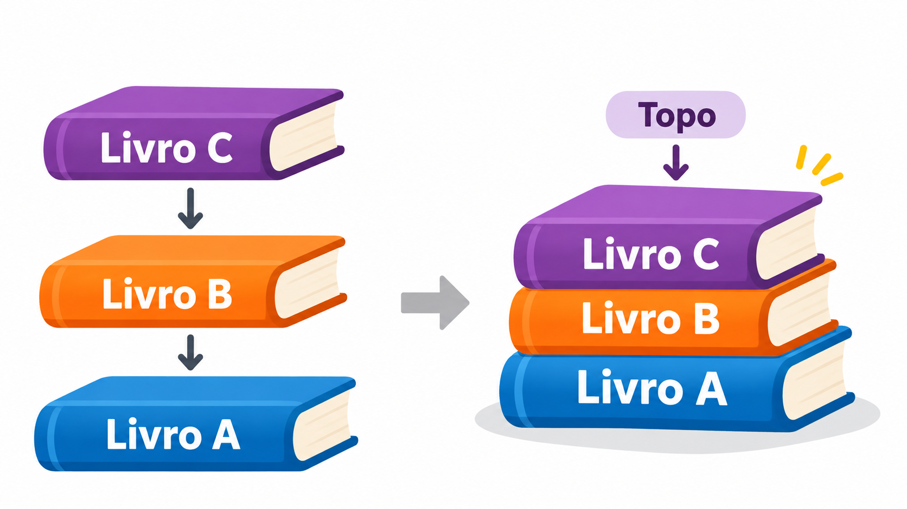
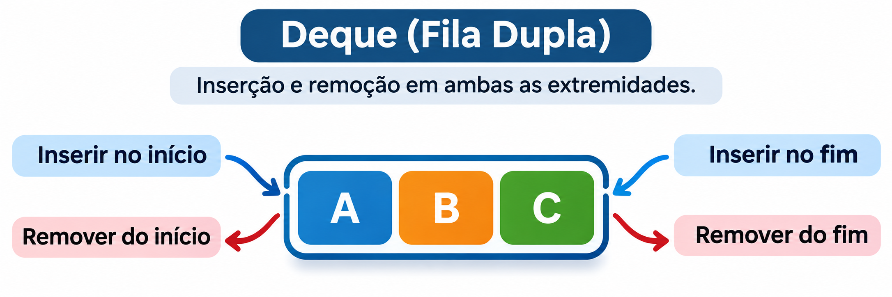

------------------------------------------------------------------------

### Estruturas de dados lineares

<br>

**Estruturas de dados lineares** organizam seus elementos em uma
sequência, na qual cada elemento ocupa uma posição definida e, em geral,
mantém relação com seu antecessor e seu sucessor.

Exemplos de estruturas lineares:

-   listas;
-   pilhas;
-   filas;
-   deques.

Nessas estruturas, os elementos são percorridos seguindo uma única
dimensão lógica de organização.

------------------------------------------------------------------------

### Tipos Abstratos de Dados (TAD)

<br>

Um Tipo Abstrato de Dados (TAD) define:

-   os dados que uma estrutura representa;
-   as operações permitidas sobre esses dados;
-   o comportamento esperado dessas operações.

**Exemplo: TAD Pilha**

-   **Dados:** uma sequência de elementos organizada pelo princípio LIFO
    (*last in, first out*);
-   **Operações:** `empilhar`, `desempilhar` e `consultar_topo`;
-   **Comportamento:** o último elemento inserido deve ser o primeiro
    elemento removido.

------------------------------------------------------------------------

## Pilhas

<br>

::: columns
::: {.column width="40%"}
::: {style="background: rgba(78, 93, 181, 0.1); backdrop-filter: blur(10px); border-radius: 10px; padding: 10px; border: 1px solid rgba(100, 87, 108, 0.3);"}
Uma pilha segue o princípio **LIFO**: o último elemento inserido é o
primeiro a ser removido.

Um exemplo cotidiano é uma pilha de livros. Para retirar um livro do
meio, é necessário retirar primeiro os livros que estão acima dele.
:::
:::

::: {.column width="60%"}
{width="100%" height="auto"}
:::
:::

------------------------------------------------------------------------

### Exemplo Pilhas (Python)

<br>

Em Python, podemos usar `append` para empilhar e `pop` para desempilhar:

``` python
pilha = []

pilha.append("Livro A")  # empilhar
pilha.append("Livro B")
pilha.append("Livro C")

livro = pilha.pop()      # desempilhar
print(livro)
print(pilha)
```

------------------------------------------------------------------------

### Operações com pilhas

<br>

``` python
pilha = []

pilha.append(10)
pilha.append(20)

# consulta o topo sem remover
topo = pilha[-1]     
print(topo)

# remove o elemento do topo
valor_topo = pilha.pop()   
print(valor_topo)
```

------------------------------------------------------------------------

### Filas

-   Uma fila segue o princípio **FIFO (First in, First out)** : o
    primeiro elemento inserido é o primeiro a ser removido.

-   Um exemplo cotidiano é uma fila de atendimento. A pessoa que chega
    primeiro deve ser atendida primeiro.

<br>

{width="80%" height="auto"}

------------------------------------------------------------------------

### Exemplo Filas (Python)

<br>

Para implementar uma fila de forma adequada, utilizamos `deque`, da
biblioteca padrão `collections`:

<br>

``` python
from collections import deque

fila = deque()

fila.append("Ana")       # entra no final
fila.append("Bia")
fila.append("Caio")

pessoa = fila.popleft()  # sai do início: Ana
print(pessoa)
print(fila)
```

------------------------------------------------------------------------

### Operações com filas

<br>

``` python
from collections import deque

fila = deque(["Ana", "Bia"])

fila.append("Caio")      # enfileirar


proxima = fila.popleft()  # desenfileirar
print(f"Atendendo: {proxima}")
print(fila)
```

<br>

**OBS:** O `deque` permite inserir no final e remover no início sem
deslocar todos os demais elementos.

------------------------------------------------------------------------

### Deques

<br>

O deque (*double-ended queue*) é uma fila de duas extremidades. Ele
permite inserir e remover elementos tanto no início quanto no final.

<br>

{width="80%" height="auto"}

------------------------------------------------------------------------

### Exemplos Deque (Python)

<br>

``` python
from collections import deque

deque_numeros = deque([2, 3])

deque_numeros.append(4)       # insere no final
deque_numeros.appendleft(1)   # insere no início

final = deque_numeros.pop()    # remove do final
inicio = deque_numeros.popleft()  # remove do início

print(inicio, final)
print(deque_numeros)
```

------------------------------------------------------------------------

### Comparação entre as estruturas

<br>

| Estrutura | Regra principal              | Operações comuns                          |
|------------------------|------------------------|------------------------|
| Lista     | sequência indexada e mutável | acessar, inserir e remover                |
| Pilha     | LIFO                         | `append` e `pop`                          |
| Fila      | FIFO                         | `append` e `popleft`                      |
| Deque     | duas extremidades            | `append`, `appendleft`, `pop` e `popleft` |

<br>

A escolha da estrutura depende da forma como os elementos serão
inseridos, acessados e removidos no problema.

## Diferença entre uma Lista e Filas

<br>

-   Uma **lista** permite acessar diretamente um elemento pelo índice em
    tempo **O(1)** e adicionar um elemento em ordem **O(1)**, pois sempre adiciona no final. Porém,
    inserir ou remover elementos no início custa **O(n)**, pois os
    demais elementos precisam ser deslocados.

-   Já um **deque**, usado como fila, permite adicionar no final e
    remover do início em **O(1)**. Em contrapartida, acessar elementos
    no meio do `deque` custa **O(n)**.

-   Prefira listas quando precisar acessar elementos por índice com
    frequência e `deque` para filas com muitas inserções e remoções nas
    extremidades.

------------------------------------------------------------------------

### Exemplo de comparação (Fila de banco)

<br>

{width="90%" height="auto"}