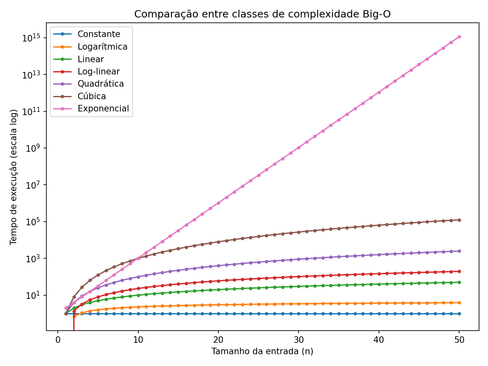

---

## Notação Big-O

<br>

####  Como comparar dois algoritmos que resolvem o mesmo problema?

<br>


A **notação Big-O** descreve como o custo (tempo ou memória) de um algoritmo cresce conforme o tamanho da entrada aumenta. Ela permite:

- uma comparação objetiva entre algoritmos;
- ignorar diferenças de poder de processamento, sistema operacional e linguagem de programação;
- entender o quanto a complexidade do algoritmo aumenta de acordo com o crescimento das entradas.

---

### Funções - O(n)

O algoritmo cresce de forma linear a medida que aumentamos o tamanho da entrada: cada elemento adicionado exige uma nova operação. Ou seja, o custo está aumentando quando aumentamos o tamanho de `n`. 

<br>

```python
# 11 passos para n = 10
def soma1(n):
    soma = 0
    for i in range(n + 1):
        soma += i

    return soma
```

```python
soma1(100)
```

<br>

A função percorre todos os valores de `0` até `n`, somando um a um.
O número de passos cresce **linearmente** com `n`: se `n` dobra, o número de operações também dobra.

---


### Exemplo - O(n)

<br>

```python
# cria uma lista com 1000 elementos
def lista1():
    lista = []
    for i in range(1000):
        lista += [i]
    return lista
```

```python
len(lista1())
```

Cada elemento é adicionado individualmente à lista dentro de um laço,
então o custo cresce proporcionalmente ao número de elementos
(**O(n)**).

---

### Funções - O(1)

O algoritmo mantém um custo constante, não importa o tamanho da entrada: o número de operações não aumenta conforme `n` cresce.

<br>

```python
# 3 passos, independente do valor de n
# O(3) -> O(1)
def soma2(n):
    return (n * (n + 1)) / 2
```

```python
soma2(10)
```

Usando a fórmula fechada da soma de uma progressão aritmética,
`soma2` sempre executa o mesmo número de operações, **não importa o
valor de `n`**. É um algoritmo de tempo **constante**.

---


### Exemplo - O(1)

Criar a sequência tem custo constante, pois os valores não são gerados de imediato; já percorrê-la cresce de forma linear com o tamanho da entrada.

<br>

```python
def lista2():
    return range(1000)
```

```python
vec_lista = lista2()

for i in vec_lista:
    print(i)
```

A função `range` não cria os 1000 valores imediatamente: ela apenas descreve a
sequência e gera os valores sob demanda. Dessa forma,
`lista2()` é executada em tempo **constante**, enquanto percorrer o
`range` com um `for` tem custo **O(n)**. 

---


### Comparar o tempo de execução 

<br>

Podemos comparar o tempo de execução das duas funções no Jupyter
usando o comando `%timeit`:

```python
%timeit soma1(10)
%timeit soma2(10)
```

Mesmo para um `n` pequeno, `soma2` tende a ser mais rápida, e essa
diferença cresce à medida que `n` aumenta.


---


### Classes de complexidade Big-O

<br>

| Notação | Nome | Crescimento |
|---|---|---|
| `O(1)` | Constante | não depende do tamanho da entrada |
| `O(log n)` | Logarítmica | cresce muito devagar |
| `O(n)` | Linear | cresce proporcionalmente a `n` |
| `O(n log n)` | Log-linear | pouco mais que linear |
| `O(n²)` | Quadrática | cresce com o quadrado de `n` |
| `O(n³)` | Cúbica | cresce com o cubo de `n` |
| `O(2ⁿ)` | Exponencial | cresce muito rapidamente |

Quanto mais à direita na tabela, mais rápido o custo do algoritmo
aumenta conforme `n` cresce.

---

### Comparando as classes de complexidade

<br>

{fig-align="center" width="70%"}


# Mais Exemplos...

---

### Big-O: Constante - O(1)

O algoritmo mantém um custo constante, não importa o tamanho da entrada: o número de operações não aumenta conforme `n` cresce.

<br>

```python
lista = [1, 2, 3, 4, 5]

def constant(n):
    print(n[0])
    print(n[1])

constant(lista)
```

<br>

Independentemente do tamanho de `lista`, a função sempre acessa um
número fixo de posições (duas), então seu custo é **O(1)**.

---

### Big-O: Linear - O(n)

<br>

O algoritmo cresce de forma linear a medida que aumentamos o tamanho da entrada: se `n` dobra, o número de operações também dobra.

<br>

```python
def linear(n):
    for i in n:
        print(i)

linear(lista)
```

<br>

A função percorre cada elemento da entrada **uma única vez**. O
número de operações cresce na mesma proporção que o tamanho de `n`.

---

### Big-O: Quadrática - O(n²)

<br>

O algoritmo cresce de forma quadrática a medida que aumentamos o tamanho da entrada: se `n` dobra, o número de operações aumenta quatro vezes.

<br>

```python
def quadratic(n):
    for i in n:
        for j in n:
            print(i, j)
        print('---')

quadratic(lista)
```

Para cada elemento de `n`, a função percorre **novamente** todos os
elementos de `n`. São dois laços aninhados, então o custo cresce com
o quadrado do tamanho da entrada.

---

### Combinando complexidades

::::: {.columns}

<br>

::: {.column width="45%"}


Ao combinar blocos de código, somamos os custos de cada trecho.
Constantes (`O(1)`, `O(5)`, `O(3)`) são descartadas e termos de
mesma ordem são agrupados: `O(9) + O(2n)` simplifica-se para **O(n)**,
pois, para `n` grande, o termo linear domina o custo total.
:::


::: {.column width="55%"}
```python
# O(1) + O(5) + O(n) + O(n) + O(3)
# O(9) + O(2n) -> O(n)

def combination(n):
    # O(1)
    print(n[0])

    # O(5)
    for i in range(5):
        print('test ', i)

    # O(n)
    for i in n:
        print(i)

    # O(n)
    for j in n:
        print(j)

    # O(3)
    print('Python')
    print('Python')
    print('Python')

combination(lista)
```
:::


:::::

---

### referências sobre custos de operações em Python

<br>

- <https://wiki.python.org/moin/TimeComplexity>
- <https://www.ics.uci.edu/~pattis/ICS-33/lectures/complexitypython.txt>
